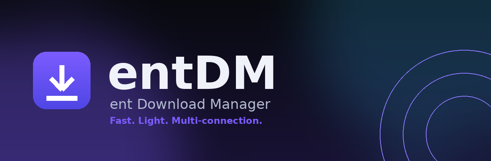
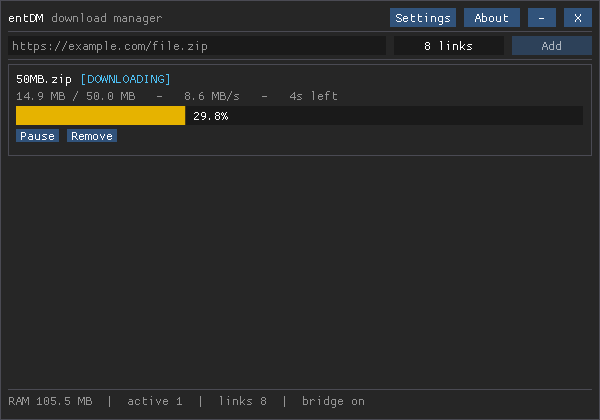

<p align="center">
  
</p>

<h1 align="center">entDM</h1>

<p align="center"><strong>ent Download Manager</strong> — fast, lightweight, multi-connection downloads for Linux.<br>
Open source. No accounts. No telemetry.</p>

<p align="center">
  <a href="https://github.com/whyefkan/entDM/releases"><strong>Download</strong></a> ·
  <a href="https://github.com/whyefkan/entDM/issues">Report a bug</a> ·
  <a href="latest.json">Update manifest</a>
</p>

<p align="center">
  
  
  
  
</p>



## Why entDM?

Most browsers download a file over a single connection. entDM splits it into
segments and downloads them in parallel, then writes each segment directly to
its final position on disk. The result is a small, native app that can saturate
your connection without a browser engine or an account.

## Features

- **Segmented downloads** — multiple parallel connections per file.
- **Persistent resume** — restart the app and continue from where you left off.
- **Automatic reconnect** — stalled connections are reopened automatically.
- **Pause and resume** — control every active download.
- **Open file / open folder** — one click when a download completes.
- **Chrome extension bridge** — capture links in Chrome and send them to entDM.
- **Low memory footprint** — native C++ desktop app.
- **11 UI languages** — English by default.

## Download

Grab the latest Linux build from [Releases](https://github.com/whyefkan/entDM/releases).

| Platform | Status |
| --- | --- |
| Linux x86_64 | Supported |
| Windows x86_64 | Supported (preview) |

Release artifacts:

- `entdm-0.1.1-Linux.deb` — Debian/Ubuntu installer
- `entdm-0.1.1-Linux.tar.gz` — portable Linux build
- `entdm-0.1.1-windows-x64-setup.exe` — Windows installer
- `entdm-windows-x64.zip` — portable Windows build

## Build from source

### Debian / Ubuntu

```bash
sudo apt install build-essential cmake pkg-config libglfw3-dev libgl1-mesa-dev libcurl4-openssl-dev
cmake -S . -B build -DCMAKE_BUILD_TYPE=Release
cmake --build build -j"$(nproc)"
./build/entdm
```

### Fedora

```bash
sudo dnf install gcc-c++ cmake pkgconf-pkg-config glfw-devel mesa-libGL-devel libcurl-devel
cmake -S . -B build -DCMAKE_BUILD_TYPE=Release
cmake --build build -j"$(nproc)"
./build/entdm
```

### Arch Linux

```bash
sudo pacman -S base-devel cmake pkgconf glfw mesa libcurl
cmake -S . -B build -DCMAKE_BUILD_TYPE=Release
cmake --build build -j"$(nproc)"
./build/entdm
```

Dear ImGui is vendored in `third_party/imgui`. GLFW, OpenGL and libcurl are
provided by the system.

### Windows

Requirements: Visual Studio 2022 Build Tools, CMake and vcpkg.

```powershell
vcpkg install glfw3:x64-windows curl:x64-windows

cmake -S . -B build -G "Visual Studio 17 2022" -A x64 `
  -DCMAKE_TOOLCHAIN_FILE="$env:VCPKG_INSTALLATION_ROOT/scripts/buildsystems/vcpkg.cmake"

cmake --build build --config Release
.\build\Release\entdm.exe
```

Windows releases also include a per-user capable installer built with Inno Setup.

## Chrome extension

1. Start entDM. The local bridge listens on `127.0.0.1:8765`.
2. Open `chrome://extensions` in Chrome.
3. Enable **Developer mode**.
4. Click **Load unpacked** and select the `extension/` folder.
5. Use **Send to entDM** from the extension popup, or enable
   **Intercept Chrome downloads** to forward new downloads automatically.

## Updates

entDM reads a small JSON manifest to check for updates:

```text
https://raw.githubusercontent.com/whyefkan/entDM/main/latest.json
```

Release policy (enforced since **v0.1.1**):

- entDM checks the manifest on startup and every 30 minutes.
- If a newer `version` is published, the app shows a blocking **Update required**
  screen until the update is installed.
- `min_version` can additionally force older versions to update.

> v0.1.0 predates the in-app updater. Install v0.1.1 once manually; later
> releases are enforced automatically.

The manifest is maintained on the `main` branch. Package URLs point to GitHub
Releases.

## Project structure

```text
src/                C++ application
extension/          Chrome extension (Manifest V3)
third_party/imgui/  Dear ImGui (MIT)
assets/             Banner, icon and screenshots
latest.json         Update manifest
```

## Contributing

Issues and pull requests are welcome. Keep changes focused, match the existing
code style, and test a real download before opening a pull request.

## License

entDM is licensed under the **Apache License 2.0**. See [LICENSE](LICENSE).

Third-party components keep their own licenses. See [NOTICE](NOTICE).
